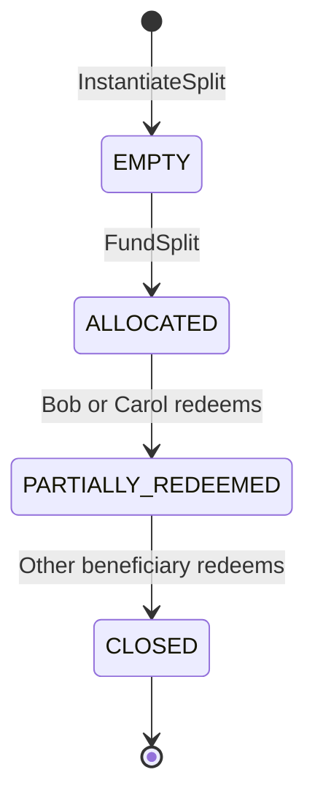
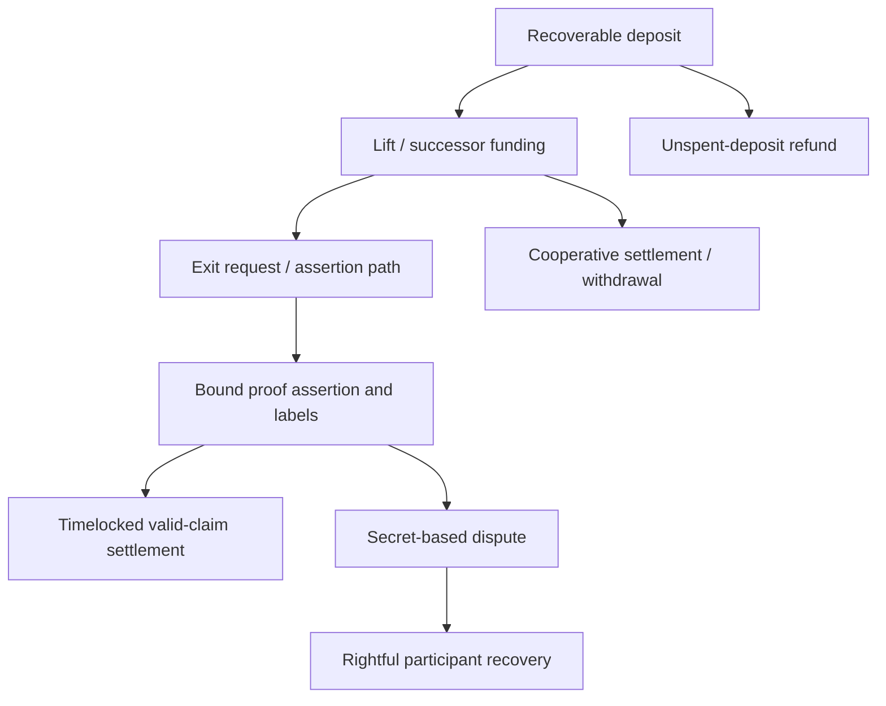

# Cube v1 specification

**Document version:** 0.2.0-draft  
**Date:** 24 October 2026  
**Target:** native BTC payments, independent recovery and an Argo-backed programmable regtest pilot  
**Companion:** [implementation.md](implementation.md)

## 1. Status, interpretation and release profiles

This is a proposed engineering specification, not a description of completed software. MUST, MUST NOT, SHOULD and MAY express requirements of this draft. A requirement is not satisfied by a diagram, database entry, unit test of a component or an unexecuted test plan.

The current scope document remains the baseline for payments and recovery. This draft adds a concrete programmable **regtest** target in response to the request to include Argo and basic programmability. It does not silently change the original Google Doc or declare those additions enabled on mainnet.

| Profile | Required behavior | Permitted conclusion |
|---|---|---|
| `PAYMENTS_V1` | V1-01–V1-18 and USD-01–USD-29 in the scope document | Payment release candidate only after its own evidence gates pass |
| `ARGO_SPLIT_REGTEST` | Payment baseline plus the fixed-split contract, real execution proofs, Argo evaluation, Bitcoin disputes and independent recovery in this specification | Integrated programmable regtest PoC after all corresponding gates pass |
| `ARGO_ESCROW_REGTEST` | Second pilot in section 16 after splitter G4; new escrow relation, conditional graph and independent outcome recovery | Escrow regtest PoC only after E-G1–E-G3 pass; no automatic mainnet enablement |
| `ARGO_SPLIT_SIGNET` | Same semantics under public-network relay, coordination and monitoring conditions | Pre-mainnet operational evidence; not production approval |
| `ARGO_SPLIT_MAINNET` | All applicable preceding requirements, concrete reviewed transaction graph, independent security review and measured deployment limits | Funded use only after explicit release acceptance |

For the requested Argo-enabled v1 development target, programmability and Argo are required work, not optional stubs. If the Argo track fails its gates, it MUST remain disabled; this does not waive any payment-baseline gate. Mainnet MUST NOT be inferred from a successful regtest run.

### 1.1 Deliberately bounded feature set

The first programmable contract is **FixedSplitVaultV1**, a single-funding BTC allocation contract with two fixed beneficiaries. It is a narrow CubeVM contract and a proof relation for that contract, not a universal verifier for arbitrary CubeVM programs.

Excluded from this pilot: arbitrary user bytecode, contract upgrades, internal/reentrant calls, unbounded loops, variable-length participant sets, tokens, bridges, swaps, price feeds, AMMs, lending, general escrow arbitration and privacy claims. Ordinary settlement timelocks remain required; contract-level clock-dependent conditions are deferred.

### 1.2 Evidence terminology

- **Specified:** a behavior required here.
- **Source-observed:** present at a pinned source revision, without a runtime claim.
- **Demonstrated:** backed by reproducible test outputs from the selected release.
- **Release accepted:** demonstrated and reviewed within the frozen threat model and configuration.

The source register in section 17 identifies the material used to prepare this draft. None of the implementation or cryptographic tests described below was executed while authoring these files.

## 2. Relationship to the Cube whitepaper

The whitepaper separates timeout-tree ownership from BitVM-style computation enforcement (PDF pp.5–9), describes a garbled Groth16 verifier (pp.7–8), introduces contract Shadowing (pp.10–18), proposes Projector signing (pp.18–24), and describes Lift and exit-ladder/fork-attestation mechanisms (pp.25–29). These are design claims, not security properties established by this draft.

| Whitepaper component | v1 treatment |
|---|---|
| Engine and batches | Deterministic coordination with participant-side checks, durable decisions and bounded batches |
| Timeout trees and VTXOs | Actual signed transaction graph, conflict rules, maturity and independently usable recovery packages |
| ZKTLC | Proposed composition of a recoverable entitlement with challengeable execution; name alone establishes no guarantee |
| BitVM3-style garbled Groth16 verifier | Argo plus a projective encoding and the selected malicious-security protocol replaces the expensive Boolean garbling component |
| CubeVM | Fixed allowlisted program and method subset with a deterministic execution-to-proof relation |
| Shadowing | Unconditional beneficiary allocations for this pilot, tied to recoverable BTC outputs |
| Projector | Separate proposed construction requiring reviewed signing and transaction obligations; value tweaks alone are insufficient |
| Exit ladder and Connector | Concrete non-cooperative exit request and transaction linkage; a Connector alone does not prove canonical-chain selection |
| Bitcoin data availability / APE | Versioned bounded encoding and independently recoverable data; a hash commitment is not publication |

At Cube commit `6dd4a09a3b6bcc7759110a4dc5e666aca1ae1938`, source inspection still finds LiftV2 rejected by the signed batch constructor, `new_projector = None` in Engine session construction, and no `Entry::Call` arm in the batch executor. Argo integration does not resolve these automatically. Detailed work locations are in the implementation plan.

## 3. First pilot: FixedSplitVaultV1

### 3.1 Why this precedes escrow

| Candidate | What it tests | Additional difficulty | Decision |
|---|---|---|---|
| Counter | Execution and arithmetic | No BTC ownership or exit semantics | Crypto/unit-test warm-up only |
| Fixed-split vault | Calls, persistent state, satoshi rounding, Shadowing, proofs and redemption | Connecting allocations to real BTC recovery | First complete pilot |
| Hashlocked/refundable escrow | Conditional payment and time-dependent recovery | Competing outcomes, maturity, preimage exposure and stale-state safety | Second pilot |
| AMM/lending | Generalized financial execution | Pricing, precision, liquidity, economic and contract risks | Outside this v1 |

A standard Bitcoin transaction can already pay two outputs. The purpose of this pilot is to demonstrate Cube's complete contract-state-to-Bitcoin enforcement path. A manually created two-output transaction, a simulated contract balance, or an unrelated bond hashlock MUST NOT be counted as the Argo-enabled PoC.

### 3.2 Actors and example

Alice is the funding account. Bob and Carol are beneficiaries. F is the disclosed execution-fee account. Their four keys are distinct in the initial profile. The Engine coordinates; an independent challenger has no participant signing keys.

One instance fixes Bob's weight at 7,000 basis points and Carol's at 3,000, with denominator 10,000. Values and identities are immutable after instantiation. Alice authorizes one gross funding amount `G` and one execution fee `E`, with `0 <= E < G`.

```text
D = G - E
B = floor(D * 7000 / 10000)
C = D - B
```

Use checked wide integer arithmetic for multiplication, then exact range checks before storing u64 satoshis. Carol receives the integer remainder. Both beneficiary allocations MUST be positive and satisfy the selected minimum-claim/exit rules. No floating point is permitted.

Example fixture: `G = 100000`, `E = 500`, `D = 99500`, `B = 69650`, `C = 29850` satoshis. The 500-sat execution fee is an illustrative contract parameter, not a Bitcoin feerate or a promised product fee. Funding, redemption and Bitcoin recovery fees are separately authorized and accounted for.

### 3.3 State and methods

```text
SplitInstance {
  contract_id: bytes32,
  template_hash: bytes32,
  owner_key: xonly_key32,
  bob_key: xonly_key32,
  carol_key: xonly_key32,
  fee_key: xonly_key32,
  gross_sats: u64,
  execution_fee_sats: u64,
  bob_weight_bps: u16 = 7000,
  carol_weight_bps: u16 = 3000,
  phase: EMPTY | ALLOCATED | PARTIALLY_REDEEMED | CLOSED,
  contract_balance_sats: u64,
  bob_shadow_sats: u64,
  carol_shadow_sats: u64,
  instance_sequence: u64
}
```

`InstantiateSplit` creates one empty instance with zero balance and zero allocations, authenticates Alice, fixes all parameters and consumes her next authorization sequence. It does not lock contract principal. `contract_id` is derived from the canonical instance descriptor, owner identity and unique instantiation operation ID.

`FundSplit` is allowed once, only in `EMPTY`, with Alice's authorization and enough eligible native funds. It atomically debits Alice by G, credits the contract by D, credits F by E, creates Bob/Carol allocations B/C and moves to `ALLOCATED`. A failure at any step MUST undo all execution changes and leave no finalized fee or allocation. Authorization/signing history is retained separately for safety.

`RedeemShare` is allowed only for Bob or Carol, authenticated by that beneficiary. It consumes that beneficiary's entire nonzero shadow allocation, decreases the contract balance by the same amount, and credits a native successor entitlement to the same beneficiary. It is a transfer between two representations of one economic claim, not an additional credit. After one redemption phase is `PARTIALLY_REDEEMED`; after both it is `CLOSED`. Partial redemption, recipient substitution, replenishment and repeated funding are unsupported.

A normal `Swapout` can subsequently withdraw the native successor claim. Engine-independent recovery MUST also cover an allocation still inside the vault, without requiring a cooperative `RedeemShare`. Both routes discharge the same economic entitlement. They MUST NOT produce two redeemable claims for one allocation.



The diagram is the logical contract lifecycle. Bitcoin recovery has a separate state machine; recovering an allocation MUST durably mark/discharge its economic claim so it cannot later be redeemed again through cooperative state.

### 3.4 Expected accounting

Assume other native balances are zero and ignore separately funded network-fee reserves:

| State | Alice native | Bob native | Carol native | F native | Contract balance | Bob shadow | Carol shadow |
|---|---:|---:|---:|---:|---:|---:|---:|
| Before funding | 100000 | 0 | 0 | 0 | 0 | 0 | 0 |
| Allocated | 0 | 0 | 0 | 500 | 99500 | 69650 | 29850 |
| Bob redeemed | 0 | 69650 | 0 | 500 | 29850 | 0 | 29850 |
| Both redeemed | 0 | 69650 | 29850 | 500 | 0 | 0 | 0 |

Physical-value accounting is `sum(native balances) + sum(contract balances)`. Shadow allocations describe obligations against contract balances and MUST NOT be added again to that total. A participant's attributable entitlement includes native value plus their remaining shadows, subject to reservations, discharge and the selected recovery graph.

The pilot uses unconditional allocations once `FundSplit` settles. Alice cannot withdraw those allocated funds, change weights or reclaim an already assigned share. This avoids pretending that an unconditional shadow balance can safely represent a still-conditional escrow obligation.

## 4. Required payment-baseline behavior

The Argo-enabled profile MUST retain the following scope; these are not deferred by focusing on the vault.

| Requirement | Required outcome |
|---|---|
| PAY-01 Wallet/configuration | User-controlled keys; network/version separation; disclosed duties before funding |
| PAY-02 Backup/restore | Keys plus signed recovery artifacts, integrity and environment checks |
| PAY-03 Deposit | Verified cooperative output and user refund for an unspent unprocessed deposit |
| PAY-04 Lifting | Safe handover to a verified successor entitlement; no protection gap |
| PAY-05 Payments | Sender authorization, recipient package verification and durable pending/settled states |
| PAY-06 Balances | Available, reserved, pending and recovering amounts separated |
| PAY-07 Refresh | Replacement verified before old protection is retired; clear expiry safety margins |
| PAY-08 Swapout | Correct Bitcoin destination/value and configured confirmations |
| PAY-09 Recovery | Depositor and recipient recover without a new Engine signature or Engine-only data |
| PAY-10 Signing | Full transaction checks, durable nonce state and idempotent retries |
| PAY-11 Encoding | Canonical bounded messages, sequence/input-consumption replay protection |
| PAY-12 Durability | Atomic recovery-critical state or explicit interruption-safe reconciliation |
| PAY-13 Chain state | Conflicts, reorgs, maturity and same-height replacements handled |
| PAY-14 Economics | Transparent execution/network fees, relay support and recovery fee access |
| PAY-15 Operations | Safe admission controls, monitoring, legacy claims and independent review |

The detailed V1/USD criteria in the source scope apply in addition to this mapping. No Engine receipt, raw database balance or local proof check alone establishes settlement.

## 5. State, identifiers and authorization

### 5.1 Consensus state

The committed execution state MUST cover account balances and authorization sequences; registered participant identities; contract descriptors, phase and storage; contract balances and shadows; consumed inputs and operation IDs; withdrawal/reservation obligations affecting spendability; and the accepted parent execution commitment. Any field that changes execution validity or entitlement is either committed here or explicitly bound in the transition statement.

Local UI timestamps, retry counters and telemetry are not consensus state. Bitcoin observations are stored as observations with block hashes; they MUST NOT be supplied by the Engine as unverified consensus facts.

For the first bounded proof, use one contract instance, four account slots and one state-mutating entry per batch. The canonical full-state serialization is acceptable instead of inventing a Merkle tree prematurely. Inactive slots and reserved bytes MUST be canonical zero. Expanding the bounds changes the circuit/version and requires new review.

### 5.2 Canonical encoding proposal

This draft proposes `cube-v1-fixed-v0` as the initial test encoding, not a claim of compatibility with existing APE:

- Unsigned integer fields are fixed-width little-endian. Signed monetary integers are forbidden.
- Keys are canonical 32-byte BIP-340 x-only secp256k1 keys, validated before use.
- Hash fields are 32 raw bytes. Bitcoin outpoints use the exact serialized transaction-hash bytes and u32 output index; display hexadecimal reversal MUST NOT enter signed bytes.
- Variable byte strings use a u32 length prefix and an enforced per-field maximum. Vectors have fixed bounds and canonical unused slots; alternate encodings and trailing bytes are rejected.
- Enum tags are frozen in the schema registry. Existing Entry method numbers MUST NOT be silently reused for a new wire meaning.
- JSON is a diagnostic/interchange view, never the consensus signing or hash encoding.

Use the BIP-340 tagged-SHA256 construction with distinct ASCII tags, including `CubeV1/State/v0`, `CubeV1/Entry/v0`, `CubeV1/Statement/v0`, `CubeV1/Instance/v0` and `CubeV1/Package/v0`. Serialized schema and golden vectors MUST be frozen before claiming interoperability. An APE adapter can follow, but must decode to exactly the same semantic objects and prove canonical round trips.

### 5.3 Entry authorization

Every entry binds schema version, network genesis hash, release profile, backend/circuit ID, caller key, caller authorization sequence, stable operation ID, expected parent state/claim IDs, method, arguments, recipient identities, G/E or approved fee bound, and the applicable target window. A sequence alone is insufficient without exact message binding; a target height alone is insufficient replay protection.

Use BIP-340 signatures for the initial pilot. If retained Cube BLS registration or aggregation remains in the acceptance path, its exact authorization equivalence and circuit constraints become additional required work. It MUST NOT be treated as interchangeable with BIP-340 by assumption.

Retries use the same operation ID and payload. A repeated ID with different bytes is a deterministic conflict. Once a signing nonce/authorization has been used, restart, reorganization and failed submission MUST NOT make it reusable.

## 6. Invariants

| ID | Invariant |
|---|---|
| INV-01 | All amounts are nonnegative, range checked and conserved; arithmetic cannot wrap in Rust or the proof field |
| INV-02 | For every contract, sum of remaining shadows is at most its balance; for an allocated split vault it equals the balance |
| INV-03 | Native and shadow representations of one entitlement cannot both be spent |
| INV-04 | Every finalized entitlement maps to a user-specific recoverable Bitcoin outcome |
| INV-05 | Prior protection remains until successor protection is secured under the selected protocol |
| INV-06 | Only authorized callers can fund/redeem; immutable parameters cannot change |
| INV-07 | An accepted operation/input cannot be consumed twice, including after restart or reorg |
| INV-08 | Proof, statement, actual assertion, accepted parent and payout obligations refer to the same transition |
| INV-09 | Engine loss cannot create a dependency on a new signature or unavailable Engine data for an already finalized claim |
| INV-10 | Failed execution cannot leave partial balances, allocations, fees or committed storage changes |
| INV-11 | No timeout, invalidity result or slashed bond is displayed as final BTC recovery without the correct confirmed output |
| INV-12 | Exiting one participant cannot erase another's still-backed entitlement or overdraw shared backing |

These must hold across cooperative transitions and adversarial recovery, not merely in the in-memory VM.

## 7. Proof statement and execution relation

### 7.1 Transition manifest

The canonical `TransitionManifest` contains:

| Group | Fields |
|---|---|
| Context | Schema/profile IDs, Bitcoin genesis hash, protocol version, circuit ID, template hash, verifier-key digest |
| Parent | Previous state digest, stable batch sequence, existing funding/claim anchor outpoint(s) |
| Execution | Entry digest, expected resulting state digest, authorization/consumption commitments |
| Entitlements | Exact recipient keys, allocation/native changes, ordered payout obligations, approved execution and network-fee rules |
| Enforcement | Setup/garbling instance ID, graph-template version, challenge/timing configuration digest, recovery-package commitments |
| Data | Canonical batch/data digest and availability/package descriptor commitments |

A symbolic graph-template digest MUST avoid circular hashing of its own final assertion transaction ID, proof, labels or embedded manifest commitment. The manifest binds existing anchors and intended payout descriptors; actual transaction construction is a deterministic reviewed function of it. Any exclusion from a hash must be documented and substitution-tested.

### 7.2 Argo's one-public-input interface

The inspected Argo verifier exposes one scalar `x`. A candidate pilot adapter computes `D = TaggedHash("CubeV1/Statement/v0", encode(manifest))` and `x = OS2IP_BE(D) mod r`, where r is the BN254 scalar-field order. The circuit MUST recompute this mapping from the complete constrained manifest, and the consumer MUST compare against its independently reconstructed manifest.

This mapping is a compression commitment, not an injective encoding of 256 bits. Its binding/security level, byte order and range implementation MUST be assessed as part of CRYPTO-01. Do not claim a lossless 256-bit public input or a blanket 128-bit end-to-end guarantee. A reviewed alternative or an explicit multi-public-input extension can replace it only under a new circuit/backend version and matching vectors.

Most importantly, public `x` and its authenticated labels MUST be bound to the Bitcoin assertion's authorized manifest/obligations. Checking `x` in a cooperative wallet alone is not sufficient if a malicious Engine can publish another valid proof/context on the unilateral path. This exact binding is an unresolved transaction-adapter acceptance requirement, not functionality furnished by Argo automatically.

### 7.3 Required relation

For supported action e, previous state S, proposed state S' and manifest M, the prover demonstrates all of:

1. S and S' serialize canonically and hash to M's exact state digests.
2. The network, template, version, backend and state anchor match M.
3. e hashes to the committed entry; all array lengths, enum values and ranges are constrained.
4. The supported caller's BIP-340 signature and exact authorization message are valid, or a separately reviewed equivalent authorization is enforced by the actual Bitcoin graph. A host-side boolean is not a circuit proof of authorization.
5. The caller sequence and consumed-input rules advance exactly once.
6. The fixed contract transition rules in section 3 hold, including immutable parameters, permitted phases and exact beneficiary identity.
7. Floor division is proven with quotient/remainder constraints: `D*7000 = B*10000 + rem`, `0 <= rem < 10000`, and `C = D-B`.
8. Every value is within the specified integer range; checked subtraction/addition and global conservation hold over integers, not only modulo r.
9. All unaffected accounts, contract fields and obligations remain unchanged.
10. Shadow/native migration and discharge preserve INV-02, INV-03 and INV-12.
11. Ordered payout and recovery obligations are derived from the same entitlements, not free witness values.
12. The complete constrained manifest maps to the verifier public input under the frozen adapter.

The relation does not certify all Bitcoin consensus or every CubeVM opcode. Actual transaction validity is tested by Bitcoin Core and enforced by scripts/signatures. If correctness depends on chain membership, proof of work, variable difficulty or inclusion of an exit request, the reviewed chain-attestation subsystem must supply that property; an RPC response cannot be relabeled as a trustless in-circuit proof.

The first circuit may be specialized to FixedSplitVaultV1, but it MUST match the actual allowlisted CubeVM execution semantics. A hand-coded toy transition circuit disconnected from accepted `Call` execution does not satisfy the integrated pilot.

## 8. Argo enforcement requirements

### 8.1 Division of responsibility

| Component | Responsibility |
|---|---|
| Cube executor | Produce the deterministic supported state transition and obligations |
| Groth16 prover | Prove the selected relation from actual execution witnesses |
| Groth16 verifier key | Fix the relation; cannot be substituted per claim |
| Argo/projective encoding | Make invalid proof evaluation yield the committed dispute evidence |
| Malicious-security setup | Prevent a cheating garbler from supplying ineffective/incorrect tables |
| Bitcoin transaction adapter | Authenticate the claimed inputs, bind context, expose required labels and enforce dispute/take/recovery branches |
| Participant/challenger | Obtain data, verify, monitor and act before relevant deadlines |
| Recovery graph | Return the rightful BTC; collateral forfeiture alone is insufficient |

Argo is required for the requested profile's verifier-garbling role. It is not a replacement for the prover, the custody protocol, the whole BitVM3 bridge, chain attestation or the release process. Do not import an operator-liquidity bridge and claim it preserves Cube's participant-controlled custody without a separate comparison.

### 8.2 Setup and lifecycle

Each active garbling instance has an ID, verifier-key digest, secret commitment, encoding version, table digest, selected malicious-security parameters, authenticated input schema and retirement rules. Secret values MUST be sampled with sufficient entropy, use canonical encoding and remain out of ordinary logs/backups/diagnostic exports.

If the evaluator uses zero as a no-disclosure sentinel, setup MUST reject a zero disclosure secret and the adapter MUST distinguish the sentinel from actual evidence. A nonzero field value is not sufficient evidence by itself: its canonical bytes must satisfy the committed Bitcoin condition.

Preserve the whitepaper's participant-scoped setup objective: prove which participant has verified which setup and how that setup protects their entitlement. Do not replace it with an unexplained external committee. Groth16 relation setup and maliciously secure garbling setup are different processes; both must be specified. If a shared setup is explored for regtest convenience, label that changed assumption and do not mark the strict participant-scoped profile complete.

One proving/verifying key can be reusable for a fixed relation subject to its proof-system assumptions. Garbling tables, input labels, masks and disclosure secrets MUST NOT be assumed reusable for arbitrary successive proofs. Generating multiple instances and retaining them for outstanding claims is part of the measured cost.

The release MUST implement the security variant required when setup precedes future proof selection. The Argo paper's adaptive encrypted-material transformation and the chosen projective scheme must be represented in actual protocol transcripts. A malicious-security mechanism such as the selected cut-and-choose/Mosaic composition must be instantiated and tested; naming Mosaic is not implementation evidence.

### 8.3 Input and output handling

Malformed encodings, invalid curve points, noncanonical coordinates, wrong-subgroup G2 elements and incompatible verifier keys MUST produce the protocol-defined safe rejection or extractable dispute result. They MUST NOT produce an unchallengeable accepted assertion. A panic or decoding error alone is not a successful fraud proof.

The integrated evaluator MUST expose the secret from every intended invalidity path, including the input-validity component. A legitimate proof MUST not expose usable dispute evidence under the selected assumptions. Wrong-context but algebraically valid proofs need explicit statement/graph binding; Argo's pairing-invalidity mechanism cannot identify a semantically misbound valid statement by itself.

At the inspected Argo revision, reproduce and resolve the unkeyed global verifier preprocessing cache, ignored successful value from the input-validity evaluator, and u64-seeded convenience API. Findings are source observations and require tests; no exploit is asserted here.

### 8.4 Cost interpretation

Argo's paper reports about 21 kB plus 25 MB of off-chain material for the single-instance honest-setup reference; it retains the compared BitVM3 on-chain transaction flow. These are research reference figures, not Cube's storage budget, recovery cost or deployment timing. Benchmark complete setup copies, actual table serialization, proving, distribution, instance retention and concurrent disputes.

## 9. Bitcoin settlement and recovery contract

### 9.1 Abstract required graph

This topology specifies obligations. It is **not** a published executable transaction graph, a proof that the composition is sound, or permission to fund an unfinished implementation.



The implementation MUST identify actual prevouts, scripts, signers and conflict relations for each edge. Deposit refund ceases when its input is spent. The successor package must then protect the participant. No path may rely on an Engine signature to be obtained after the Engine has disappeared.

### 9.2 Required transaction roles

| Logical role | Required property |
|---|---|
| `Deposit` | Participant+Engine cooperation plus verified user recovery for an unprocessed unspent deposit |
| `SuccessorFunding` | Creates the reviewed ownership tree/claims; validates value, signer coverage and recovery material before handover |
| `CooperativeSettle` | Pays only authorized successor obligations and preserves conflict protection |
| `ExitRequest` | Records the refused operation and binds a specific existing claim/anchor; specifies deadlines and data disclosure |
| `Assert` | Authenticates the actual proof/input labels and statement; releases material required for independent evaluation |
| `Take` | Cannot finalize an invalid claim without an effective contest opportunity; values and recipients remain bound |
| `Disprove` | Consumes/verifiably conflicts with the incorrect claim's settlement path using extractable evidence |
| `Recovery` | Completes the correct participant's BTC redemption, including tree dependencies and fee strategy |
| `ForkAttest` if used | Links the intended exit/Connector while separately justifying canonical-chain and inclusion properties |

Some roles may be combined or require multiple transactions. Every role must have explicit witness templates and Bitcoin-node demonstrations before the graph gate passes.

### 9.3 Graph acceptance checklist

For each funded claim, retain and review:

1. Full funding and parent/branch/leaf transactions, input values, scripts, outputs and control blocks.
2. Complete signatures or demonstrably participant-local signing capability for each required future spend.
3. Exact `nVersion`, `nLockTime`, input sequence, sighash mode and maturity interpretation.
4. Commitment to statement, garbling instance, disclosure secret and payout obligations.
5. The conflict mechanism that blocks an incorrect `Take`; an unrelated slashed bond is insufficient.
6. Correct recovery after valid claims, invalid claims, silence, withheld labels and interrupted setup.
7. Prevention of stale-state, double-recovery and shared-backing theft, including one recipient exiting while another remains.
8. Actual relay/standardness behavior and approved fee-bumping paths, without weakening signatures or principal protection.
9. Compatibility between participant-scoped setups and a shared tree. Protection of Alice alone does not establish protection for Bob or Carol.
10. Exact finite progress/maturity conditions for each path and treatment of all broadcast races.

If Projector key projection is used, signing MUST still validate full transaction obligations, ordered signer/value arrays, context and nonce state. Standard MuSig2 and value-bound key tweaks do not by themselves prove covenant behavior. A safe alternative must be explicitly named and compared; it must not silently change the custody target.

### 9.4 Open design boundary

The complete Cube-specific transaction graph, statement-to-label Bitcoin binding and contract-shadow recovery composition remain design work. They are first-class blockers `GRAPH-01`, `BIND-01` and `SHADOW-EXIT-01`. The documents intentionally do not invent Script hex or claim an unspecified "ZKTLC" makes them work. Resolving these blockers means delivering executable descriptors, reviewable signing rules and adversarial node tests, not deleting the blocker labels.

## 10. Data availability and recovery packages

A required `RecoveryPackage` includes the claim ID and predecessor ID; beneficiary key; protocol/backend/schema/circuit IDs; current entitlement and discharge state; signed graph and dependencies; witnesses/control blocks; anchor outpoints; timings; approved fee rules; accepted state/entry/manifest digests; and all setup, label, proof and challenge material needed under the selected path. Large blobs can be content-addressed, but all essential bytes must be durably local or independently obtainable before the dependent protection is surrendered.

An on-chain digest alone is not data availability. The release MUST inventory which bytes are actually published, when they are revealed and how a fresh recipient reconstructs the latest accepted state if the Engine vanishes. If the profile claims Bitcoin DA, the complete specified data must be recoverable through the selected Bitcoin publication protocol; a private Engine API is not equivalent. A local-package-only regtest experiment must state its narrower model and cannot close `DA-01` for the whitepaper profile.

An exit forced from contract-held value MUST include enough state/authorization evidence to determine the beneficiary's entitlement. A backup consisting of wallet words and a contract balance number is insufficient.

Permissionless challengers do not get wallet private keys. Watchtower packages separate public challenge data from private recovery/signing secrets. Integrity, encryption, authentication, size limits and version checks are mandatory for backup import/export.

## 11. Operational state machines and durability

### 11.1 Operation lifecycle

```text
DRAFT -> RESERVED -> AUTHORIZED -> SUBMITTED -> CHALLENGE_PENDING -> SETTLED
                                  |                    |
                                  +-> RECONCILING       +-> DISPUTED -> RECOVERING
```

These are observation/operation states, not a substitute for the concrete graph. Some cooperative paths may omit an assertion stage only where the frozen protocol justifies that omission. `PROOF_VERIFIED` is evidence attached to an operation, not a synonym for `SETTLED`.

`SETTLED` requires the exact supported chain/challenge conditions, no unresolved incompatible spend and durable complete recovery material. `RECOVERED` additionally requires the final participant-controlled Bitcoin output and configured confirmations. A crash or RPC timeout leaves an unknown outcome requiring reconciliation; it does not automatically release reserved inputs.

### 11.2 Atomicity and signing

Persist authorization intent, input reservation, consumed operation ID and nonce state before dependent responses/signatures. Commit execution deltas, package inventories and accepted-state references atomically, or prove an interruption-safe journal/reconciliation protocol for the exact multi-store design. The existing collection of Sled managers cannot be assumed globally atomic.

On restart, rescan chain/mempool and reconcile prepared, signed, submitted and confirmed records. Reject conflicting retries and preserve original recovery. Reorg rollback affects chain observations and execution acceptance according to protocol rules; it MUST NOT erase old signatures, disclosure events or nonce consumption.

### 11.3 Admission and upgrades

Block new funding when the graph/backend is unsupported, packages are unavailable, monitor lag is unsafe, fee access is insufficient or review gates are open. Pausing admission MUST preserve already-required recovery, challenge, data-retention and legacy interpretation services. A backend upgrade requires a reviewed participant-authorized handover; existing claims retain their original semantics.

## 12. Initial regtest parameters

These values are proposed fixtures for early tests, not current Cube defaults, proven compatible graph parameters or mainnet recommendations. The graph gate must validate the resulting timing relationships and off-by-one boundaries.

| Parameter | Initial fixture |
|---|---:|
| Logical account slots | 4: Alice, Bob, Carol, F |
| Split instances in one proof | 1 |
| State-mutating entries per batch | 1 |
| Beneficiaries | 2, distinct fixed keys |
| Example G / E | 100000 / 500 sats |
| Maximum amount accepted by circuit | At most Bitcoin's 2100000000000000-sat supply bound; lower resource/dust limits also apply |
| Funding confirmation count | 3 blocks |
| Final payout/recovery confirmation count | 6 blocks |
| Deposit relative refund fixture | 144 blocks |
| Claim lifetime fixture | 432 blocks |
| Refresh safety margin fixture | 144 blocks |
| Challenge-delay fixture | 12 blocks |
| Post-dispute recovery-delay fixture | 6 blocks, if the selected graph uses such a delay |
| Maximum recovery branch depth fixture | 4 |
| Fee scenario inputs | 2, 10, 50 and 100 sat/vB |

Use block-based encoding deliberately and verify against Bitcoin Core. Do not label a block count as a guaranteed calendar duration. No maximum complete exit latency or fee cap follows from this table. Derive each complete path from its actual parent confirmations, timelocks, transaction dependencies, inclusion assumptions and fee strategy.

Additional limits such as artifact sizes, prover memory, timeouts and concurrent disputes must be frozen from measurements. Before those limits exist, oversized input tests use explicit harness bounds and report them as test-only.

## 13. Test and acceptance specification

Every test record includes source/config digests, scenario seed, expected/observed outcomes and evidence paths. IDs below are shared with the implementation plan.

| Test | Required observation |
|---|---|
| T-01 Baseline journey | Deposit, lift, transfer, refresh, swapout and final correct Bitcoin outputs |
| T-02 Split allocation | Exact G/E/B/C arithmetic, immutable identities and expected committed state |
| T-03 Rounding | Nondivisible amounts satisfy quotient/remainder and preserve every satoshi |
| T-04 Invalid contract calls | Wrong caller, repeated funding, stale sequence, duplicate/conflicting ID, wrong method and unsupported template rejected atomically |
| T-05 Redemption order | Bob-then-Carol and Carol-then-Bob produce the same economic outcome; a redeemed share cannot be spent again |
| T-06 Real execution proof | Fixed-key Groth16 proofs from actual supported execution; altered arithmetic/witness/authorization fails |
| T-07 Context binding | Wrong batch/state/outpoint/network/recipient/circuit or substituted verifier key rejected, including otherwise valid proofs for another manifest |
| T-08 Argo invalidity | Correct secret recovered for invalid proofs under authentic assertion labels; legitimate proofs do not disclose it in the tested construction |
| T-09 Malformed inputs | Curve/range/subgroup/serialization cases safely rejected or dispute-enforceable through the full evaluator and node path |
| T-10 Dishonest setup | Corrupt tables, inconsistent commitments and label equivocation cannot produce an accepted unchallengeable claim under selected setup parameters |
| T-11 Actual dispute | Invalid `Take` stopped through its real conflicting/consuming path; rightful participant reaches confirmed BTC recovery |
| T-12 Engine loss | Kill Engine and its data endpoint; recover depositor, ordinary recipient, Bob shadow and Carol shadow claims from retained material |
| T-13 Noninterference | One recipient's independent exit preserves another's entitlement; concurrent redemption/exit cannot duplicate value |
| T-14 Crash boundaries | Crash around reservation, signing, nonce persistence, package write, state commit, broadcast and acknowledgement; recover one safe outcome |
| T-15 Chain changes | Reorg, same-height replacement, stale fork, spent parent and reorg during dispute handled without false settlement or replay |
| T-16 Timing/fees | Before/at/after maturity, expiry, stalled refresh, policy relay failures and fee pressure behave as specified |
| T-17 Restore | Replacement device and independent Bitcoin node recover with original device and Engine unavailable |
| T-18 Resource limits | Bounded decoder, proof/table sizes, concurrency, memory/storage and complete fee costs measured and admission enforced |
| T-19 Version safety | Legacy recovery survives new-backend admission pause; incompatible claims and silent migration rejected |
| T-20 VM/proof equivalence | Independent reference model, actual allowed CubeVM execution and proof witness agree across generated valid and invalid cases |

Successful allocation arithmetic does not pass T-11 or T-12. A secret printed to stdout does not pass T-11. Validity enforced only by the test harness does not pass T-07. A direct Bitcoin splitter without the proof/dispute linkage does not pass the integrated profile.

## 14. Release gates

| Gate | Evidence required | Can proceed when incomplete? |
|---|---|---|
| G0 Reproducible baseline | Source/toolchain pins, isolated harness and source-gap inventory | Modeling only |
| G1 Ownership/graph design | Executable concrete graph, signing rules, recovery continuity and GRAPH-01/BIND-01/SHADOW-EXIT-01 resolved for the bounded profile | No integrated funding/protection claim |
| G2 Contract execution | T-02–T-05 and state invariants through actual Call dispatch | Proof prototyping only |
| G3 Proof and garbling | Real relation, authorization coverage, CRYPTO-01 resolved and T-06–T-10/T-20 | No protected-BTC claim without G1 |
| G4 Integrated regtest | All applicable T-01–T-20; adversarial BTC recovery, not mocks | PoC evidence, no mainnet |
| G5 Public-network validation | Signet coordination/relay tests, complete cost/deadline data, production-parameter design | No mainnet |
| G6 Mainnet acceptance | Independent composition/custody review, remediated findings, frozen configuration, measured exposure controls and runbooks | Funded profile remains disabled |

Regtest permits deterministic mining and invalid-case injection; it does not measure mainnet censorship, fee markets, hashpower security or difficulty changes. The independent review must address those differences and the actual setup, cryptographic and availability assumptions.

## 15. Open decisions that block stronger claims

| ID | Decision | Evidence that closes it |
|---|---|---|
| GRAPH-01 | Complete ownership/dispute transaction graph and conflict protection | Concrete raw/PSBT transactions, scripts, witnesses, signer obligations and adversarial node tests |
| BIND-01 | Manifest/public input/labels/payout binding on a malicious unilateral path | Valid-wrong-context proofs cannot release incorrect funds in node tests and reviewed construction |
| SHADOW-EXIT-01 | Allocation-to-BTC recovery and multi-recipient noninterference | Bob and Carol recover correct shares independently after Engine loss |
| CRYPTO-01 | Circuit backend, public-input commitment, BIP-340 relation, setup/adaptive/malicious composition and actual security target | Pinned implementation, vectors, proof-size/performance results and cryptographic review |
| DA-01 | Complete independently recoverable data and selected Bitcoin publication model | New participant reconstructs supported accepted claims without Engine service |
| CHAIN-01 | Canonical-chain and exit-request attestation | Verified selected construction including reorg/fork tests; Connector existence alone is not sufficient |
| PROJECTOR-01 | Value-projected signing or explicitly compared alternative | Reviewed complete-message signing rules, nonce safety and actual graph enforcement |
| ECON-01 | Complete fees, setup multiplicity, retention, collateral/liquidity and exposure | Measurements and safe admission limits against supported scenarios |

These open decisions make this a detailed development draft, not a frozen deployable consensus specification. Before G1/G3, the implementation must amend this file with the selected concrete descriptors and cryptographic parameters; unresolved items cannot be filled by assumed trustlessness.

## 16. Second pilot: fixed hashlocked/refundable escrow

**The next pilot after FixedSplitVaultV1 is a fixed hashlocked/refundable escrow, named FixedHashlockEscrowV1.** Begin its integration after the splitter reaches G4. Include it in the v1 development plan as a second regtest profile; the splitter's success does not automatically enable escrow-funded use.

### 16.1 Parties, immutable terms and example

Alice locks BTC for Bob. Bob can claim with the correct secret and his own authorization. Alice gains a refund path when its Bitcoin block-height condition matures, provided the same entitlement remains unspent. No arbitrator, oracle, partial payment, replenishment, recipient change or contract upgrade is included.

Before funding, fix the instance/template/circuit/backend IDs, Alice/Bob/fee keys, gross amount G, disclosed execution fee E, locked principal P=G-E, secret hash, refund height, parent outpoint, authorization sequence, graph/setup IDs, fee policy and complete conditional recovery-package commitments. Keys must be distinct and validated in this profile.

The application hash is SHA256 of exactly 32 secret bytes. Bob SHOULD generate the secret and communicate its hash through an authenticated request. Hash knowledge alone is not evidence that Bob knows the preimage. The application preimage, Argo invalid-proof disclosure secret and adaptive-material decryption key are separate values with distinct encodings/domains.

Illustrative fixture: G=100000, E=500, P=99500 sats. Funding atomically debits Alice by G, credits the contract by P and the fee account by E. Claim and refund are competing outcomes for the same P. Outcome selection cannot mint another principal or charge the funding fee again. Subsequent network/execution fees require separate explicit authorization and accounting.

### 16.2 Methods and accepted states

| Method | Preconditions | Proposed accepted-state result |
|---|---|---|
| InstantiateEscrow | Alice authorizes the immutable supported terms | EMPTY, zero locked principal |
| FundEscrow | EMPTY, Alice authorization, eligible funds, verified complete conditional recovery packages | OPEN, P locked, funding fee applied once |
| ClaimEscrow | OPEN, Bob authorization, 32-byte preimage matching the hash, valid current claim/anchor | CLAIMED; P assigned exclusively to Bob under the frozen settlement rules |
| RefundEscrow | OPEN, Alice authorization, mature refund branch under verified Bitcoin conditions, no finalized incompatible discharge | REFUNDED; P assigned exclusively to Alice |
| RedeemEscrow | Caller owns the settled outcome and entitlement is unspent | One native successor entitlement or final BTC recovery; CLOSED after discharge |

CLAIMED and REFUNDED are mutually exclusive economic outcomes. A request, reservation, local proof check or mempool observation remains pending until the selected settlement conditions pass. Direct Bitcoin recovery must discharge the same claim and cannot be paid again through cooperative redemption.

There is **no automatic claim cutoff** at refund_height in this first profile. Maturity enables Alice's refund branch; Bob's hashlocked path may remain valid until a conflicting spend wins. Resolve post-maturity races through the frozen graph and canonical Bitcoin settlement, not the first Engine receipt or a database timestamp. A hard beneficiary cutoff would require different explicitly proven semantics.

Use a block-height-typed absolute refund condition and BIP-65/CLTV-compatible transaction locktime and input sequence where applicable. An Engine-supplied height or host boolean does not establish maturity. Test the exact Core-defined eligibility boundary rather than assuming an off-by-one interpretation.

### 16.3 Conditional ownership and independent recovery

Do not copy the splitter's unconditional Shadow model unchanged. While OPEN, neither party gets a freely spendable unconditional shadow over P. Represent the alternative outcomes in a new versioned conditional entitlement backed by the actual conflict-protected graph. Two potential recipients are two outcomes of one principal, not two backed balances to add together.

Leaving only an Engine account balance and zero recovery rights is also insufficient. Before funding, Alice must possess a verifiable future refund path and Bob the supported preimage-conditional claim path. Each eligible outcome must be independently recoverable without a fresh Engine signature or Engine-only data.

Only a settled outcome can become the winner's unconditional native/shadow successor. The losing path and every older version must be unspendable or conflicted under the actual graph. An old Alice refund cannot reclaim Bob's settled entitlement, and an already-paid Bob claim cannot consume Alice's settled refund.

### 16.4 Real proofs and Argo

Use a new escrow template hash, relation/circuit ID, verifier-key digest and fresh garbling/setup instances. Constrain actual SHA256/preimage length, caller authorization, immutable terms, phase, sequence, state roots, principal/fees and exact outcome obligations. Establish maturity through verified chain evidence or actual Bitcoin script enforcement in a reviewed composition; an unconstrained witness height is forbidden.

Argo protects the resulting invalid-proof dispute under sections 7–10. It does not create conditional ownership, choose the canonical winner or enforce refund maturity by itself. Revealing a preimage may expose it publicly even if a transaction is unconfirmed or later reorganized. The pilot makes no privacy promise after disclosure, and retries must retain that exposure history.

### 16.5 Escrow user stories

| ID | User story | Acceptance criteria |
|---|---|---|
| EUSD-01 | As Alice, I want to fund the agreed escrow | Verify parties, principal/fees, hash, maturity and complete outcome packages; reject changed terms or unsafe handover |
| EUSD-02 | As Bob, I want to claim with my secret | Correct secret plus Bob authorization pays only Bob; wrong length/hash/key and duplicate claims fail atomically |
| EUSD-03 | As Alice, I want the specified refund option | Premature refund fails on Bitcoin; an eligible mature refund pays only Alice when its conflict path wins |
| EUSD-04 | As either party, I want safe race handling | Competing submissions never pay twice; pending/confirmed/reorganized status follows graph and chain evidence |
| EUSD-05 | As either party, I want independent recovery | Restore the required package on a new device and settle the eligible outcome with Engine/original client unavailable |
| EUSD-06 | As a reviewer, I want enforceable proof protection | Invalid assertions are defeated through Argo and the real graph; valid-wrong-context proofs cannot release wrong-party principal |

### 16.6 Escrow tests and inclusion gates

| Test | Required scenario |
|---|---|
| E-T01 | Real funding, correct-secret claim, beneficiary redemption and final confirmed BTC |
| E-T02 | Wrong secret/length/caller, altered terms, repeated funding and stale/replayed claim rejected |
| E-T03 | Refund before, at and after the Core-defined locktime/height boundary |
| E-T04 | Post-maturity claim/refund races in both broadcast/inclusion orders; exactly one discharge |
| E-T05 | Engine loss and fresh-device restoration for Bob's conditional claim and Alice's mature refund in separate fresh runs |
| E-T06 | Actual execution proofs, Argo-invalid assertions, malformed proof inputs and valid-wrong-context binding attempts |
| E-T07 | Reorg during confirmation, crash after preimage exposure and stale pre-outcome claims cannot double-recover |
| E-T08 | Withheld/corrupt data, insufficient/escalating fees, setup-version mismatch and missing packages handled safely |

E-G1 requires concrete conditional entitlement, claim/refund graph and reviewed time/conflict rules. E-G2 requires actual VM/circuit equivalence, real proof generation and the bound Argo adapter for that graph. E-G3 requires E-T01–E-T08, EUSD-01–EUSD-06 and affected baseline regressions to pass on regtest. Repeat G5/G6 for the escrow-enabled profile before public-network acceptance and funded mainnet. Passing the splitter does not close these escrow gates.

## 17. Sources and provenance

1. User-supplied **Cube whitepaper.pdf**, 40 PDF pages: pp.5–9 ownership/ZKTLC/BitVM; pp.10–18 CubeVM/Shadowing; pp.18–24 Projector; pp.25–29 Lift/exit ladder; pp.30–40 APE/projections. Statements of trustlessness in that paper are attributed proposals, not adopted proofs.
2. [Cube v1 scope document](https://docs.google.com/document/d/1VwM000-hAnBWnLHZJJhbX13I_PGfw8wJ1lB_EJE-LOg), including its Argo assessment and conditional-extension tabs, read on 24 October 2026.
3. [Cube source](https://github.com/cube-btc/cube/tree/6dd4a09a3b6bcc7759110a4dc5e666aca1ae1938), source-inspected revision retrieved on 24 October 2026.
4. [Argo paper 2026/2165](https://eprint.iacr.org/2026/2165), 19 October 2026 revision, especially §2.5, Tables 1–2 and §§7–8; supplied PDF read locally.
5. [Argo source](https://github.com/idealgroup/argo/tree/aa28ba884f9af3d41265774a882d4efd9f4d9b95), source-inspected revision retrieved on 24 October 2026.
6. [BitVM3 paper](https://bitvm.org/bitvm3.pdf): computation-enforcement framework; its bridge assumptions are not automatically Cube's custody assumptions.
7. [Mosaic](https://eprint.iacr.org/2026/812) and [Argo MAC](https://eprint.iacr.org/2026/049): related constructions, not a demonstrated Cube integration.
8. [BIP-327 MuSig2](https://github.com/bitcoin/bips/blob/master/bip-0327.mediawiki), [BIP-340 Schnorr](https://github.com/bitcoin/bips/blob/master/bip-0340.mediawiki), [BIP-65 absolute locktime](https://github.com/bitcoin/bips/blob/master/bip-0065.mediawiki), [BIP-68](https://github.com/bitcoin/bips/blob/master/bip-0068.mediawiki), [BIP-112](https://github.com/bitcoin/bips/blob/master/bip-0112.mediawiki), [BIP-341](https://github.com/bitcoin/bips/blob/master/bip-0341.mediawiki). Freeze the applicable specification revisions when the implementation is pinned.

The only exact amounts and block counts introduced by this draft are illustrative/test configuration choices. No new performance benchmark, cryptographic proof, execution test, delivery date or mainnet approval is claimed.
